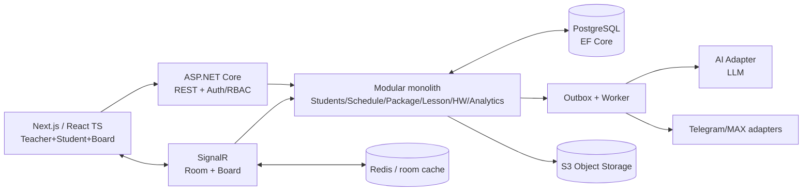

# Historical MASTER_TZ (snapshot before 2026-11-14)

This file is archived context only. Current priority, current task and acceptance are in `RELEASE_PLAN.md`, `HANDOFF.md` and `PHASE_CHECKLISTS.md`.

# MASTER ТЗ И ПЛАН РАЗРАБОТКИ — TEACHER AI STUDENT

> **АКТУАЛЬНАЯ ПРИОРИТЕТНАЯ ПРАВКА от 2026-11-11.** Первоначальный документ ниже сохранён как описание долгосрочного замысла, но старый P00→P15 порядок **больше не является планом выполнения**. Сначала M01→M05: source audit и tenant/subject model → защищённые PostgreSQL/API на сервере → полный импорт Google Sheets → подключение **существующей** `EGA/config/manage.html` → безопасный production cutover. Затем M06: универсальная админка для многих преподавателей любых предметов, потом M07: интерактивные уроки/AI. Рабочий порядок, статус и готовность — в `.ai/tas/TASK_BOARD.md` и `.ai/tas/HANDOFF.md`. До cutover действующие GAS/Sheets являются источником истины; новый backend ещё не продакшн. Сведения об образце по математике — **частный кейс** универсальной модели.

**Версия:** 1.1 · **11.11.2026** · **Статус:** план TAS, адаптированный к существующему `Arthur200014/testing-hosting`. В репозитории уже присутствуют отдельные серверные модули и учебные интерактивы; полнота нового продукта ещё не проверена.

> Постоянный документ в Git. Для нового чата сначала прочесть краткий `.ai/tas/HANDOFF.md`, затем **только нужную часть** этого ТЗ. Фактический код `main` важнее плана.

## 1. Зачем нужен продукт

**TEACHER AI STUDENT** — SaaS-платформа для частного репетитора и маленькой онлайн-школы: ученики, расписание, абонементы, посещения, общий онлайн-урок с полноценной доской, интерактивные задания, домашка, аналитика, Telegram/MAX, ИИ-подбор следующего шага. Всё связано одной моделью данных и идентификаторами ученика/занятия.

**Главная проблема:** репетиторы часами готовят уроки, наглядные объяснения и домашние задания, а затем проверяют ответы. Кроме того, результаты и административная информация часто разнесены по отдельным сервисам. Основная ценность TAS — проверяемая генерация интерактивной теории из повторно используемых механик, автоматизируемая проверка ДЗ и рекомендации по реальным учебным событиям. Календарь и абонементы — дополнительные полезные модули.

**Главный пользователь:** учитель/репетитор. **Ученики** участвуют в уроке и сдают ДЗ. **Родитель** получает разрешённые отчёты, полноценный отдельный кабинет — позже. **Мини-школа** — расширяемая модель, не обязательное enterprise решение в первом релизе.

## 2. Ценность и гипотеза монетизации

Старую модель времени из ранней презентации **25,0 → 10,3 ч** не использовать как обоснованный результат: она завышает долю календаря и абонементов. Основные измерения пилота: время на создание интерактивного урока, составление ДЗ, автоматическую проверку и педагогические правки. Цена для тестирования **1 490 ₽/мес**, стоимость часа в расчёте 700 ₽, точка окупаемости — около 2,13 часа. Ни экономия, ни конверсия пока не подтверждены, эти числа требуют измерения на пилоте.

Проверить на 10–15 пилотных репетиторах: baseline/после, сколько платят/готовы платить, ошибки учёта, завершение сценариев, потерянные уведомления. Не утверждать рыночные/экономические цифры как доказанный результат без источника.

## 3. Что входит в MVP

1. **Управление:** карточки учеников, роли/организации, календарь с переносами, абонемент и баланс занятий, история посещений.
2. **Проведение:** вход по ссылке/коду, комната урока, синхронная доска с рисованием, ластиком, отменой и восстановлением после обрыва связи.
3. **Учебный контент:** LessonDefinition и 5–10 готовых переиспользуемых шаблонов; попытки с результатами.
4. **Домашка:** выдача с дедлайном, сдача, проверка и повторное назначение по правилам.
5. **Аналитика:** отчёт по фактическим событиям, без выдуманных процентов и нуля вместо отсутствующих данных.
6. **Уведомления:** Telegram Bot API, MAX при доступе и модерации (иначе documented `BLOCKED_EXTERNAL` + fallback); in-app статусы.
7. **ИИ:** Builder генерирует валидную структуру урока из templates/tasks, Curator предлагает ресурсы по уже имеющимся IDs; преподаватель утверждает.
8. **Основа безопасности:** tenant isolation, RBAC, аудит, idempotent ledger, CI, backup/restore, legal review до ученических ПД.

**НЕ в первом MVP:** встроенная видеосвязь, приём платежей/эквайринг, родительское полноценное приложение, нативные мобильные приложения, маркетплейс, ненужная микросервисность.

## 4. Архитектура, которую нельзя пересматривать без ADR

**Почему этот стек:** Next.js/React для сложных интерактивных кабинетов; C#/ASP.NET Core для общего backend и финансово-учебных правил; SignalR для событий в реальном времени; PostgreSQL для транзакций абонементов; Redis только для временного состояния/ускорения (при реальном масштабировании — backplane); Worker/Outbox для безопасных повторов уведомлений; AI/Bot adapters для сменяемых провайдеров.

**Не ломать 4 инварианта:**
- Дебет занятия ровно один раз, повтор `complete` идемпотентен, корректировка — ledger reversal.
- Чужой ученик/tenant никогда не доступен по чужому ID или room-link.
- Подтверждённые события доски после reconnect не теряются и не удваиваются.
- Недоступность TG/MAX/LLM не откатывает занятия, балансы и ДЗ.

## 5. Один сквозной сценарий — цель первого релиза

1. Учитель добавляет ученика и пакет 8 занятий.
2. Назначает урок на выбранную дату, переносит при необходимости.
3. Ученик заходит по ссылке, оба рисуют/решают задания на одной доске.
4. Учитель нажимает «завершить»: сохраняются результат и **одно** списание с 8 до 7.
5. Учитель назначает ДЗ, ученик сдаёт, учитель проверяет.
6. Уведомление отправляется в разрешённый канал, либо остаётся в очереди при сбое.
7. Отчёт и ИИ-куратор предлагают следующий реальный ресурс из банка задач.
8. Повтор, reconnect, сеть/LLM сбой не портят данные.

Это `E2E-01`; пока он не пройден с тестами, говорить «платформа готова» нельзя.

## 6. Этапы работ от начала до конца

| Этап | Суть | Что является результатом |
|---|---|---|
| **P00** | Выборочный аудит существующего `testing-hosting` | подтверждённая карта компонентов, тесты, handoff |
| **P01** | Интервью, правила абонементов и scope | согласованный business spec |
| **P02** | UX сценарии, ERD, API, HLD | clickable prototype, schema/contract |
| **P03** | Skeleton, CI, Docker и миграции | чистый локальный запуск и зелёный CI |
| **P04** | Auth, роли, организация/tenant | кабинеты + negative access tests |
| **P05** | Ученики и календарь | создание/перенос урока + сохранение даты |
| **P06** | Абонементы, ledger, посещения | честный баланс, concurrency/idempotency tests |
| **P07** | Комната + онлайн-доска | 2 браузера, undo/erase/reconnect |
| **P08** | Template Engine и интерактивы | reusable lesson + task bank + results |
| **P09** | Домашка | assign→submit→review E2E |
| **P10** | Аналитика/отчёты | проверяемые показатели без фейков |
| **P11** | Outbox/TG/MAX | Telegram end-to-end, MAX pass/blocked |
| **P12** | AI Builder + Curator | валидные IDs, ручное утверждение |
| **P13** | Безопасность, QA, бэкап | полные тесты, backup restore, legal gate |
| **P14** | Пилот/релиз | реальные измерения, Go/No-go, релиз |
| **P15** | Post-MVP | оплачиваемые улучшения по метрикам |

**Исторический порядок P00→P15 сохранён ниже как справка, но для исполнения заменён на M01→M07.** Операционный источник — `.ai/tas/TASK_BOARD.md`; прежние 92 задачи и фазы перенесены в архивные файлы в `.ai/tas/`.

## 7. Календарь и ресурсы

Сентябрь–декабрь 2026 — **учебный baseline презентации**. Это не подтверждение того, что уже шла разработка с сентября. 4 ноября — праздничный день, 3 ноября — предпраздничный сокращённый, 31 декабря 2026 — выходной; предусмотреть time gaps на UX review, QA, интеграцию и pilot.

Если проект делает один человек с ИИ-помощником, **пересчитать сроки**: четыре месяца для описанного MVP агрессивны. Переносить необязательные возможности, но не жертвовать целостностью балансов, безопасностью и тестами.

Роли/функции: PO/BA (требования и решения), UX/UI, frontend, backend, AI/integrations, QA, DevOps. Один участник может выполнять несколько функций.

## 8. Правила разработки и передачи между чатами

1. **Source of truth:** код `main` → `AGENTS.md` → `.ai/START_HERE.md` → `.ai/tas/HANDOFF.md` → текущая задача `TASK_BOARD.md` → актуальные `docs/architecture/` → ТЗ.
2. В новом чате использовать `.ai/tas/NEW_CHAT_PROMPT.md`; читать только `HANDOFF.md`, блок актуальной задачи, чеклист нужной фазы, связанную task-память и конкретные файлы кода. Старый ZIP не нужен.
3. `NEXT_ACTION` указывается одним ID. Перед работой сверить реальное состояние репозитория. Нет репо — `P00-01`.
4. Один task ID — небольшое конкретное изменение + тест + коммит + handoff.
5. `DONE` = изменённые файлы, проверка, доказательство, commit hash и принятый gate.
6. Обновлять `HANDOFF`, `TASK_BOARD`, `TEST_RESULTS`; архитектурное изменение через ADR в `DECISIONS`.
7. Нельзя втихую менять стек, превращать продукт в генератор интерактивов, добавлять оплату/видеосвязь в MVP или изменять другие пользовательские репозитории.

## 9. Старт прямо сейчас

**CURRENT_PHASE:** M01 — безопасный перенос данных и универсальная модель.
**REPO:** `Arthur200014/testing-hosting` (`main`).
**NEXT_ACTION:** `M01-01` — точечная матрица листы Sheets → entities PostgreSQL → действия существующей manage; без чтения всех интерактивов и без миграции реальных строк.

## 10. Где искать детали в текущем репозитории

- `.ai/tas/README.md` — навигация и принцип «одна задача за раз».
- `.ai/tas/TASK_BOARD.md` и `.ai/tas/PHASE_CHECKLISTS.md` — 92 задачи и 16 фаз.
- `.ai/tas/HANDOFF.md` — подтверждённое состояние и NEXT_ACTION.
- `.ai/tas/DECISIONS.md` и `.ai/tas/TEST_RESULTS.md` — принятые решения и результаты проверок.
- `AGENTS.md` и `.ai/START_HERE.md` — глобальные правила работы и коммитов.
- `.ai/CONTEXT_MAP.md` — выборочный поиск нужных файлов.
- `platform/README.md`, `docs/architecture/platform-foundation.md`, `compose.yaml` — существующий сервер и тесты.
- `shared/interactive/v1/` — общий интерактивный runtime.
